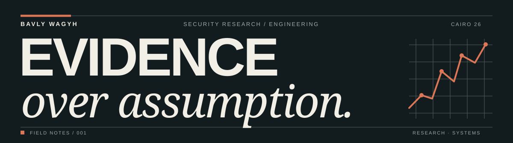
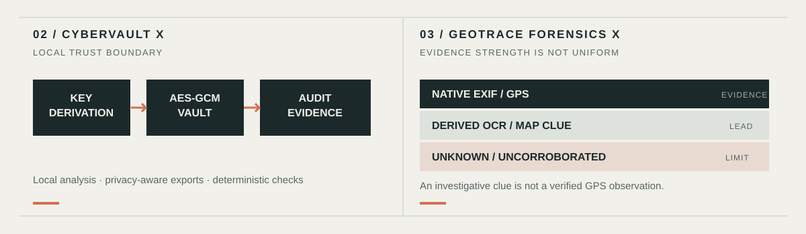

  <picture>
    <source media="(max-width: 640px)" srcset="./assets/identity-mobile.svg" />
    
  </picture>

  <b>Vulnerability research · Forensic engineering · Evidence-aware systems</b>
   
  Cairo, Egypt &nbsp; / &nbsp;
  <a href="mailto:bavlywagyh@gmail.com">Email</a> &nbsp; / &nbsp;
  <a href="https://www.linkedin.com/in/bavly-wagyh-9a4645208/">LinkedIn</a> &nbsp; / &nbsp;
  <a href="https://github.com/bavlybibo?tab=repositories">Code</a>

I investigate how security guarantees break, and build systems that make their own evidence inspectable. My focus is practical: **reproduce the behavior, bound the claim, preserve the proof.**

---

## Selected casework

### 01 / SATELLITE EVIDENCE  [INSIDER LENS](https://github.com/bavlybibo/Insider-Lens)

**NASA Space Apps Cairo 2026 · Local Winner · Working public release**

One source sees a hotspot; another does not. Is that a change in fire activity, a difference in sensors, or missing observation opportunity? Insider Lens makes the *retained and excluded evidence* visible before anyone draws a trend.

| **568** | **10,524** | **G4 withheld** |
| :-- | :-- | :-- |
| Distinct positive cell-day keys in a fixed Canada study | Source records retained under both-native policy | Unqualified cross-sensor adjustment not released |

These are evidence-partition counts, **not** physical wildfire counts or validated detection rates.

  <a href="https://insider-lens.pages.dev/?region=canada&view=retention"><b>Open the live investigation</b></a>
  &nbsp; · &nbsp;
  <a href="https://github.com/bavlybibo/Insider-Lens"><b>Source</b></a>
  &nbsp; · &nbsp;
  <a href="https://github.com/bavlybibo/Insider-Lens/blob/main/docs/SCIENTIFIC_SCOPE.md"><b>Scientific limits</b></a>

### 02 / LOCAL SECURITY  [CYBERVAULT X](https://github.com/bavlybibo/CyberVaultX)

A local password-security research prototype built around **AES-GCM-encrypted storage**, an auditable proof center, encrypted backups, deterministic security coaching, and privacy-safe reports. Its public repository contains code, regression tests, a threat model, and explicit limitations.

### 03 / DIGITAL FORENSICS  [GEOTRACE FORENSICS X](https://github.com/bavlybibo/geotrace-forensics)

A Windows-first forensic image workbench combining **EXIF/GPS extraction**, SHA-256 evidence integrity, custody records, OCR/map leads, and shareable reports. It keeps native location evidence separate from unverified investigative clues.

<picture>
  <source media="(max-width: 640px)" srcset="./assets/systems-mobile.svg" />
  
</picture>

Above: conceptual workflow illustrations, **not application screenshots**. CyberVault X is an academic prototype; GeoTrace is a public release candidate.

**Also built:** Wireless Policy Manager / WiGuard Nexus — role-to-SSID and VLAN controls, policy validation, audit history and reporting. [Team repository](https://github.com/moayadayman15/WiGuard-Nexus-Packet-Tracer-Intelligence).

---

## Research record

| | |
| :-- | :-- |
| **Accepted security research** | Apple · Huawei · Porsche — closed reports; private details remain subject to disclosure terms |
| **NASA Space Apps Cairo 2026** | Local Winner with Insider Lens; **not** a global nominee |
| **ICMTC Cybersecurity 2026** | Top 5 qualifiers / Top 10 final, as a team |
| **Research practice** | Authorized scope → reproduction → impact evidence → remediation guidance |

### Currently developing — Insider Eye

An ongoing policy-aware insider-threat platform combining endpoint controls, Linux/security workflows, backend services, and AI-based detection research. Development and evaluation are active; this is **not** presented as a completed production product.

---

## Working principles

**01 · Minimize assumptions** &nbsp; / &nbsp; **02 · Keep provenance** &nbsp; / &nbsp; **03 · Test the edge cases** &nbsp; / &nbsp; **04 · Explain the limits**

**Tools and systems:** Python, JavaScript, Linux, Burp Suite, Wireshark, Flask, PyQt, MapLibre, Git.

**Background:** B.S. Network & Cyber Security Technology, Elsewedy University of Technology (expected 2027). Enterprise IT/security experience through Elsewedy ESC, Orange Business, and Egyptian Arab Land Bank.

  <a href="mailto:bavlywagyh@gmail.com"><b>Discuss research or engineering →</b></a>
   Bavly Wagyh · Cairo, Egypt · Build carefully, verify independently.

