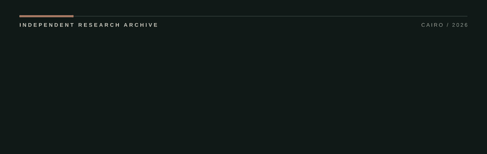
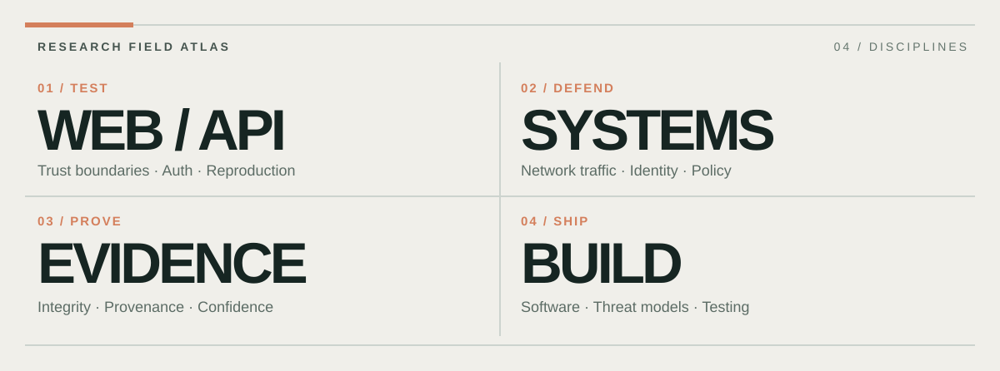
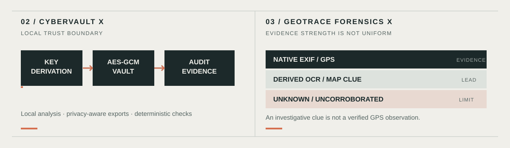

<picture>
  <source media="(prefers-reduced-motion: reduce) and (max-width: 640px)" srcset="./assets/cover-mobile.svg" />
  <source media="(prefers-reduced-motion: reduce)" srcset="./assets/cover.svg" />
  <source media="(max-width: 640px)" srcset="./assets/cover-mobile-motion.gif" />
  
</picture>

  <b>Web & API Security&nbsp; / &nbsp;Vulnerability Research&nbsp; / &nbsp;Security Engineering&nbsp; / &nbsp;Digital Forensics</b>
   
  <a href="mailto:bavlywagyh@gmail.com">Email</a> &nbsp;·&nbsp;
  <a href="https://www.linkedin.com/in/bavly-wagyh-9a4645208/">LinkedIn</a> &nbsp;·&nbsp;
  <a href="https://github.com/bavlybibo?tab=repositories">Repositories</a>

I'm **Bavly Wagyh**, a Network & Cyber Security Technology undergraduate at **Elsewedy University of Technology (SUT), Egypt** (expected graduation: **2027**).

I work at the intersection of **offensive security, practical software engineering, and evidence-driven analysis**. I investigate web and API vulnerabilities within authorized scope, reproduce security behavior, and build tools that make technical claims testable. I'm particularly interested in where a system's *actual guarantees* differ from what its interface or documentation suggests.

| Security research | Engineering | Background |
| :-- | :-- | :-- |
| Accepted, closed **paid** vulnerability reports involving **Apple, Huawei & Porsche** | Deployed investigation tools, security prototypes, testing and documentation | Cybersecurity undergraduate · hands-on IT, networking and security training |

---

## 01 / What I actually do

<picture>
  <source media="(max-width: 640px)" srcset="./assets/field-atlas-mobile.svg" />
  
</picture>

My work is organized around **testing a claim, examining the system, preserving evidence, and building a verified result.**

<b>Explore what each security discipline means in practice</b>

| Focus | Practice |
| :-- | :-- |
| **Web & API security** | Authorized penetration testing, request/response analysis, authentication and authorization testing, bug bounty research, reproducible reporting. |
| **Network & systems security** | Traffic analysis, network segmentation, identity and access controls, Windows/Linux administration, security monitoring workflows. |
| **Digital forensics** | EXIF/GPS investigation, integrity hashing, evidence provenance, chain of custody, and explicit confidence boundaries. |
| **Security product engineering** | Python-backed tools, web interfaces, automated checks, threat models, and research prototypes that make limitations visible. |

### Languages, platforms & tools

**Programming:** Python · JavaScript · PHP · C++ · Java  
**Web & data:** HTML/CSS · SQL/MySQL · Flask · Laravel · REST APIs

<b>Explore the full security and engineering toolkit</b>

| | Working stack |
| :-- | :-- |
| **Offensive security** | Burp Suite · Nmap · Nuclei · sqlmap · Metasploit · subfinder · gobuster · wfuzz |
| **Networks & forensics** | Wireshark · TCP/IP · firewall operations · EXIF/GPS analysis · SHA-256 evidence workflows |
| **Systems & development** | Linux (Kali/Ubuntu) · Windows/Windows Server · Git · PyQt · MapLibre |

The stack spans projects, labs, university work and technical training; it isn't a claim of equal mastery or professional certification in every tool.

---

## 02 / Selected engineering & research work

### CASE 01 / SATELLITE EVIDENCE [Insider Lens](https://github.com/bavlybibo/Insider-Lens)

**NASA Space Apps Cairo 2026 — Local Winner · Publicly deployed · Team of three**

Satellite hotspot maps can look certain even when the sensors disagree. Insider Lens lets an investigator compare **MODIS and VIIRS**, inspect the observation opportunity, and see which evidence is retained or withheld before drawing a conclusion. My work included the application's experience and engineering, release validation, and evidence-aware presentation.

| **568** | **10,524** | **G4 withheld** |
| :-- | :-- | :-- |
| Distinct positive cell-day keys in a fixed Canadian study | Retained source records under the both-native policy | Unqualified cross-sensor adjustment was not released |

Evidence-partition counts only; **not** physical wildfire counts or validated detection rates.

**[Live investigation](https://insider-lens.pages.dev/?region=canada&view=retention)** · **[Source & reproducibility](https://github.com/bavlybibo/Insider-Lens)** · **[Scientific scope](https://github.com/bavlybibo/Insider-Lens/blob/main/docs/SCIENTIFIC_SCOPE.md)**

### CASE 02 / LOCAL SECURITY [CyberVault X](https://github.com/bavlybibo/CyberVaultX)

An academic local-security prototype with **AES-GCM encrypted storage**, password-derived keys, encrypted backups, audit evidence, privacy-aware reports and regression tests. It is documented with a threat model and explicit technical limitations, not presented as an audited commercial password manager.

### CASE 03 / FORENSIC PROVENANCE [GeoTrace Forensics X](https://github.com/bavlybibo/geotrace-forensics)

A Windows-first image-investigation workbench with **EXIF/GPS inspection, SHA-256 integrity evidence, case records, OCR/map leads and reporting**. The key distinction: a lead inferred from an image is **not** a verified native GPS observation.

<picture>
  <source media="(prefers-reduced-motion: reduce) and (max-width: 640px)" srcset="./assets/systems-mobile.svg" />
  <source media="(prefers-reduced-motion: reduce)" srcset="./assets/systems.svg" />
  <source media="(max-width: 640px)" srcset="./assets/systems-mobile-motion.gif" />
  
</picture>

Diagrams are original workflow illustrations, **not product screenshots**.

**Also:** [WiGuard Nexus / Wireless Policy Manager](https://github.com/moayadayman15/WiGuard-Nexus-Packet-Tracer-Intelligence) — a team project for SSID/VLAN and role-policy validation, audit records and reporting · [Principal Mirage reproduction](https://github.com/bavlybibo/principal-mirage-repro) — a public security-research reproduction/prototype.

---

## 03 / Security research & competitive practice

| Record | Context |
| :-- | :-- |
| **Responsible disclosure** | Accepted and closed **paid** findings involving **Apple, Huawei and Porsche**. Private report details remain subject to disclosure conditions. |
| **NASA Space Apps Cairo 2026** | **Local Winner** with Insider Lens; the team was **not** selected as a global nominee. |
| **ICMTC Cybersecurity 2026** | Team reached **Top 5 in qualifiers** and **Top 10 in the final**. |
| **CTF practice** | Hands-on challenges spanning web security, digital forensics, cryptography, reverse engineering, pwn and OSINT. |

My reporting loop: **understand the boundary → reproduce the behavior → establish impact → document evidence and limitations → recommend a fix**.

---

## 04 / Education, training & credentials

### Formal education

**B.S. in Network & Cyber Security Technology**  
**Elsewedy University of Technology (SUT), Egypt** · Expected **2027**

Academic and applied work across web security, networks, operating systems, secure software, authentication, threat modeling and AI/ML-related cybersecurity topics.

### Practical industry training

| Organization | Hands-on focus |
| :-- | :-- |
| **Orange Business** | Network-security training; Fortinet/Palo Alto firewall operations and SOC L1/L2 workflows. |
| **Elsewedy ESC** | Enterprise infrastructure, Windows Server and Active Directory, data-center and identity/security workflows. |
| **Egyptian Arab Land Bank (EALB)** | IT and network/security internship: Windows/domain work, routing and NAT, Laravel/API basics and secure-coding practice. |

### Course certificates & structured learning

The following are **course or completion credentials**, not claims of professional licensure or expert-level certification:

- **Google** — Cybersecurity Certificate
- **IBM SkillsBuild** — Cybersecurity Fundamentals
- **TryHackMe** — Junior Penetration Tester learning path
- **ITI** — Ethical Hacking and Computer Networks Implementation
- **Meta** — JavaScript Developer learning certificate

**Additional study:** eJPT/eWPT and Cisco CCNA learning tracks. **Passing their professional certification exams is not claimed here.** Credential verification links can be added when available.

---

## 05 / Currently on the workbench

**Insider Eye — active development, not a finished product.**

An ongoing insider-threat security platform exploring policy-aware endpoint workflows, backend controls, trustworthy telemetry and AI-assisted detection evaluation. I'm treating it as both a serious academic engineering effort and a longer-term security product research direction.

I care about four questions in any system I build: **What is the threat model? What can we verify? What remains uncertain? What breaks at the edge?**

---

  <b>Research, a security finding, or a system worth building?</b> 
  <a href="mailto:bavlywagyh@gmail.com"><b>Let's talk</b></a> &nbsp;·&nbsp;
  <a href="https://www.linkedin.com/in/bavly-wagyh-9a4645208/">LinkedIn</a>
   Bavly Wagyh · Cairo, Egypt · Practical security, independently checkable evidence.

