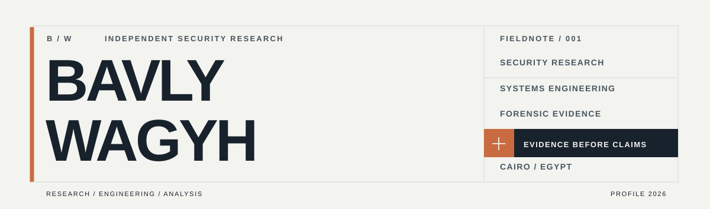
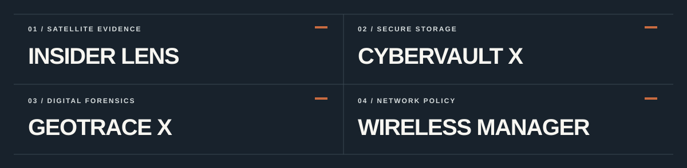

  <picture>
    <source media="(max-width: 640px)" srcset="./assets/bavly-cover-mobile.svg" />
    
  </picture>

  <a href="mailto:bavlywagyh@gmail.com">Email</a> &nbsp;·&nbsp;
  <a href="https://www.linkedin.com/in/bavly-wagyh-9a4645208/">LinkedIn</a> &nbsp;·&nbsp;
  <a href="https://github.com/bavlybibo?tab=repositories">Repositories</a>

---

### A security claim is only as useful as the evidence behind it.

I'm **Bavly Wagyh**, a cybersecurity undergraduate in Cairo, Egypt. I investigate vulnerabilities, build security-focused tools, and care about the difference between a feature that looks convincing and one that can be independently tested.

My work spans **Web/API security**, **digital forensics**, **security systems engineering**, and **evidence-aware analysis**. I prefer clear threat models, reproducible findings, honest limitations, and useful interfaces.

 

## 01 / Selected work

<picture>
  <source media="(max-width: 640px)" srcset="./assets/work-index-mobile.svg" />
  
</picture>

### 01 — [Insider Lens](https://github.com/bavlybibo/Insider-Lens)
**Satellite evidence / NASA Space Apps Cairo 2026**

A working, publicly deployed wildfire-hotspot exploration project built with a three-person team. It compares **MODIS and VIIRS** observations with bounded region/time controls, source-separated evidence, and explicit handling of analytical limits.

[Live project](https://insider-lens.pages.dev) · [Source and technical notes](https://github.com/bavlybibo/Insider-Lens)

### 02 — CyberVault X
**Encryption / local security workflows**

A security-focused vault featuring **AES-GCM encryption**, password-derived key protection, audit records, encrypted backup workflows, and privacy-aware reporting. The project emphasizes safeguards and testable behavior over decorative security claims.

### 03 — GeoTrace Forensics X
**Digital forensics / evidence provenance**

A desktop investigation workflow for **EXIF and GPS metadata**, timeline reconstruction, SHA-256 integrity checks, chain-of-custody logging, geolocation analysis, and shareable case reports.

### 04 — Wireless Policy Manager
**Network segmentation / access policy**

A policy-oriented wireless management prototype covering **SSID/VLAN and role mapping**, isolation controls, audit trails, event review, and report exports.

Project descriptions reflect implemented prototypes and documented workflows; they are not claims of production deployment or certification.

 

## 02 / Research & recognition

| Area | Selected evidence |
| :-- | :-- |
| **Responsible disclosure** | Accepted and closed vulnerability research involving **Apple, Huawei, and Porsche**. Details shared only where disclosure terms permit. |
| **NASA Space Apps Cairo 2026** | **Local Winner** with **Insider Lens**; not represented as a global nominee. |
| **ICMTC Cybersecurity 2026** | Team placed **Top 5 in qualifiers** and **Top 10 in the final**. |
| **Security reporting** | Reproducible findings, impact analysis, and remediation-oriented documentation within authorized scope. |

 

## 03 / On the workbench

**Insider Eye — active development**

Developing a policy-aware insider-threat security platform that combines endpoint workflows, backend controls, analytics, and AI-assisted detection research. This is **ongoing engineering and research**, not a finished commercial product.

I am particularly interested in the contract between a model, the data it receives, the policy boundaries around that data, and the evidence needed to trust an alert.

 

## 04 / Methods over labels

| **Observe** | **Reproduce** | **Constrain** | **Explain** |
| :-- | :-- | :-- | :-- |
| Establish the system and trust boundaries. | Turn hypotheses into repeatable tests. | Separate verified behavior from assumptions. | Produce evidence people can use. |

**Working tools:** Python · JavaScript · PHP · Linux · Burp Suite · Wireshark · Flask · PyQt · MapLibre · Git

**Education:** B.S. Network & Cyber Security Technology, Elsewedy University of Technology (SUT) — expected 2027.

**Experience:** Security research in authorized programs · IT infrastructure training at Elsewedy ESC · Network security training at Orange Business · IT/security internship at Egyptian Arab Land Bank.

 

---

  <strong>Interested in the work, the evidence, or a technical discussion?</strong> 
  <a href="mailto:bavlywagyh@gmail.com">bavlywagyh@gmail.com</a> &nbsp;·&nbsp;
  <a href="https://www.linkedin.com/in/bavly-wagyh-9a4645208/">LinkedIn</a>

Build carefully. Test honestly. Document what holds.

